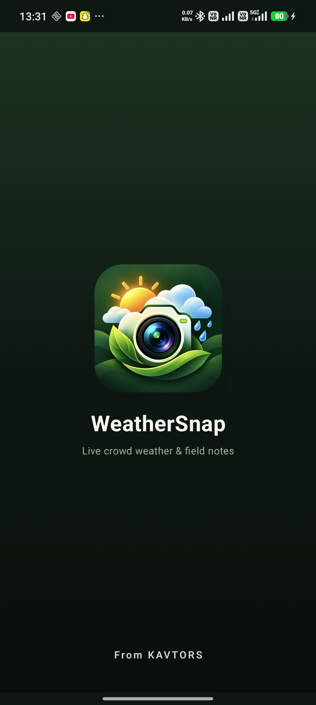
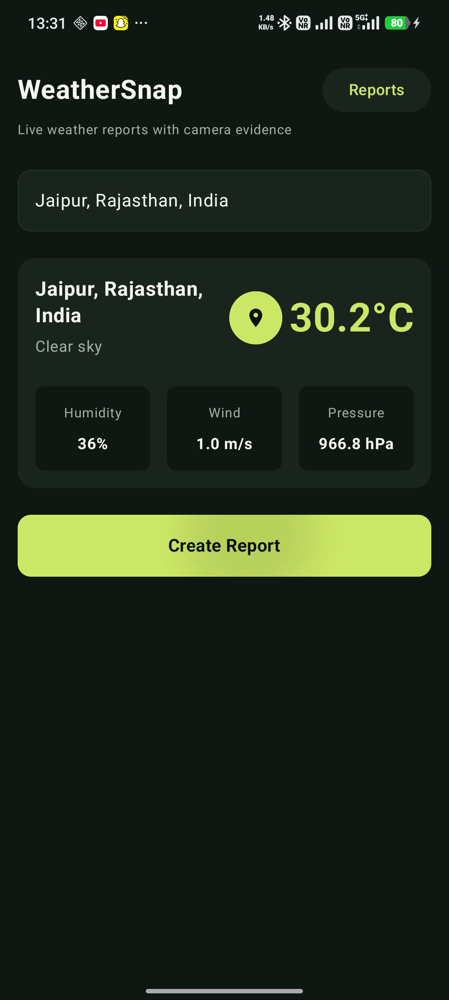
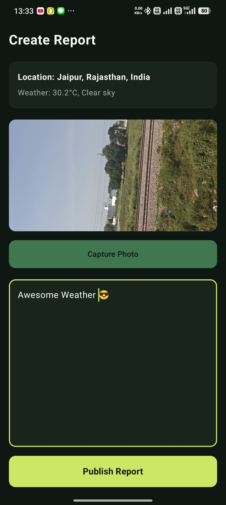
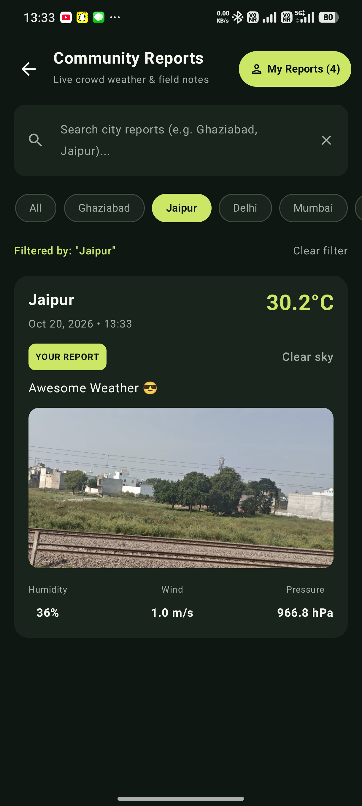
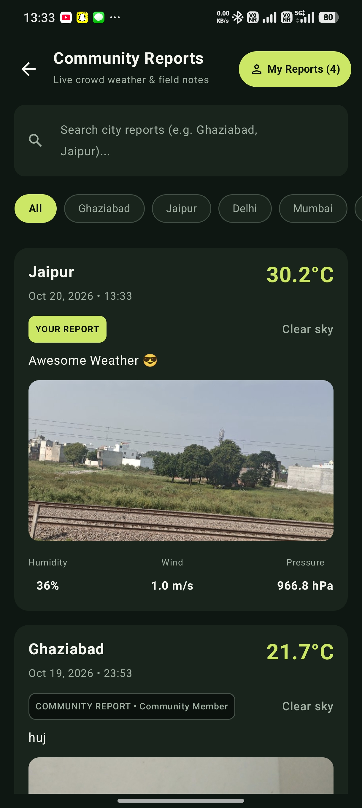
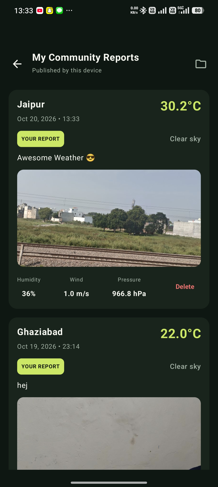

# WeatherSnap

> **Live crowd weather & field notes with camera evidence**

WeatherSnap is a modern Android application built with **Modern Android Development (MAD)** practices: **Kotlin**, **Jetpack Compose (Material 3)**, **MVVM Clean Architecture**, **Hilt**, **Room Database**, **CameraX**, **Retrofit (Open-Meteo API)**, and **Supabase (Realtime Community Reports & Cloud Storage)**.

---

## Features

- **Branded Splash Screen**: Atmospheric botanical launch screen with developer attribution ("From KAVTORS").
- **Live Meteorological Data**: Real-time temperature, weather conditions, humidity, wind speed, and atmospheric pressure powered by Open-Meteo.
- **City Search & Autocomplete**: Debounce-assisted global geocoding search with persistent last-queried city restoration.
- **Camera Evidence Capture**: Custom in-app CameraX viewfinder for capturing ground-truth weather photos.
- **Local Saved Reports**: Offline-first storage using Room database with reverse-chronological history.
- **Community Reports Feed**: Cloud-backed crowd weather reports powered by Supabase with live real-time synchronization.
- **Full-Screen Photo Viewer**: High-resolution image preview dialog with smooth zoom and dismiss gestures.
- **Material 3 Botanical Design System**: Cohesive dark-forest green and lime accent palette.

---

## Screenshots

<p align="center">
  
  
  
</p>

<p align="center">
  <b>Branded Splash</b> &nbsp;&nbsp;&nbsp;&nbsp;&nbsp;&nbsp;&nbsp;&nbsp;&nbsp;&nbsp;&nbsp;&nbsp;&nbsp;&nbsp;&nbsp;&nbsp;&nbsp;&nbsp;&nbsp;&nbsp;
  <b>Home Screen</b> &nbsp;&nbsp;&nbsp;&nbsp;&nbsp;&nbsp;&nbsp;&nbsp;&nbsp;&nbsp;&nbsp;&nbsp;&nbsp;&nbsp;&nbsp;&nbsp;&nbsp;&nbsp;&nbsp;&nbsp;
  <b>Capture & Report</b>
</p>

<p align="center">
  
  
  
</p>

<p align="center">
  <b>Saved Reports (Room)</b> &nbsp;&nbsp;&nbsp;&nbsp;&nbsp;&nbsp;&nbsp;&nbsp;&nbsp;&nbsp;&nbsp;&nbsp;&nbsp;&nbsp;
  <b>Community Feed (Realtime)</b> &nbsp;&nbsp;&nbsp;&nbsp;&nbsp;&nbsp;&nbsp;&nbsp;&nbsp;&nbsp;&nbsp;&nbsp;&nbsp;&nbsp;
  <b>My Reports Management</b>
</p>

---

## Tech Stack & Architecture

| Layer / Concern | Technology | Notes |
|---|---|---|
| **Language** | Kotlin 2.2.10 | Modern Android Development |
| **UI Framework** | Jetpack Compose (BOM 2026.02.01) | Material 3 Dark theme, edge-to-edge |
| **Architecture** | MVVM + Clean Architecture | Repository pattern, unidirectional data flow |
| **Dependency Injection** | Dagger Hilt 2.58 | Singleton scope, `@AndroidEntryPoint` |
| **Local Persistence** | Room 2.6.1 | SQLite ORM, Flow-based queries |
| **Camera Integration** | CameraX 1.4.1 | Custom lifecycle-bound in-app camera capture |
| **Remote Weather API** | Retrofit 2.11.0 + OkHttp 4.12.0 | Open-Meteo forecast and geocoding |
| **Cloud Community Backend** | Supabase Kotlin SDK 3.1.1 | Anonymous Auth, Postgrest, Storage, Realtime |
| **Image Loading** | Coil Compose 2.7.0 | Asynchronous image decoding and caching |

---

## Project Structure

```text
app/src/main/java/com/example/weathersnap/
├── data/
│   ├── local/          # Room Database, DAOs, Entities, SharedPreferences
│   ├── remote/         # Retrofit Open-Meteo API, Supabase Auth & DTOs
│   ├── repository/     # WeatherRepository & SupabaseCommunityReportRepository implementations
│   └── util/           # Image compression utilities
├── domain/
│   ├── model/          # Weather, City, Report, and CommunityReport domain models
│   └── repository/     # Domain repository interfaces
├── presentation/
│   ├── common/         # FullScreenPhotoViewerDialog and shared UI components
│   ├── community/      # CommunityReportsScreen, MyReportsScreen & ViewModels
│   ├── create_report/  # CreateReportScreen & ViewModel
│   ├── reports/        # SavedReportsScreen & ViewModel (Local Room)
│   ├── splash/         # SplashScreen ("From KAVTORS")
│   └── weather/        # WeatherScreen & ViewModel (Home)
└── ui/theme/           # Material 3 Color tokens, Typography, Theme
```

---

## Getting Started

### 1. Clone the repository

```bash
git clone https://github.com/programmer-kunal/WeatherSnap.git
```

### 2. Configure Local Properties

Create or update `local.properties` in the project root:

```properties
sdk.dir=/path/to/your/android/sdk
SUPABASE_URL=https://your-project-id.supabase.co
SUPABASE_PUBLISHABLE_KEY=your-supabase-publishable-key
```

### 3. Setup Supabase Backend (Optional for Community Reports)

Execute the SQL scripts located in the `supabase/` directory in your Supabase SQL Editor:
1. `supabase/01_community_reports_schema.sql` (Database table, RLS policies, indexes)
2. `supabase/02_storage_setup.sql` (Storage bucket `report-photos` and access policies)

Detailed instructions are provided in [`supabase/SETUP_INSTRUCTIONS.md`](supabase/SETUP_INSTRUCTIONS.md).

### 4. Build and Run

```bash
./gradlew assembleDebug
```

Install the debug APK on your device or emulator:
```bash
adb install app/build/outputs/apk/debug/app-debug.apk
```

---

## Developer

**Kunal (KAVTORS)**  
GitHub: [programmer-kunal](https://github.com/programmer-kunal)
